  

### Prazer, Daniel.

Sou desenvolvedor e data analyst na **Nobrelar Homecenter** e founder da **NAV**. Estudo na **Universidade Federal do Ceará (UFC)**.

 

  

## O que eu faço

- **Automações:** ERP, CRM e WhatsApp conversando entre si, inclusive sistema que não tem API.
- **Dados:** análise, painéis financeiros e dashboards que mostram onde a empresa ganha e onde perde.
- **Resolução de problemas:** primeiro entendo a causa, depois escrevo o código.
- **Liderança:** desenho fluxo, treino o time e acompanho resultado de perto.

 

## NAV

A **NAV** existe pra tirar empresa do manual e do achismo. A gente entra com dados e automação: painel financeiro, dashboard completo e processo rodando sozinho, sempre de olho no crescimento.

Bastidores e cases no Instagram: [@navhubce](https://www.instagram.com/navhubce/)

## Aprendendo agora

- Java e Programação Orientada a Objetos
- Circuitos Digitais
- Arquitetura de Computadores

## Certificações

## Em construção

Um projeto de Programação Orientada a Objetos em Java, pra faculdade. O histórico fica em [alvsdaniel/POO](https://github.com/alvsdaniel/POO).

## Linguagens

## Bora conversar

## Meus números no GitHub

  

