  

## Sobre

Desenvolvedor e Data Analyst na **Nobrelar Homecenter**, onde também lidero as frentes de **CRM e processos**. Founder da **NAV**.

Atuo na interseção entre tecnologia, finanças e operação comercial: transformo dado operacional em informação financeira confiável, automatizo processos que impactam margem e custo e estruturo os indicadores que sustentam decisões de negócio.

Meu trabalho vai do levantamento do problema à entrega em produção: integrações entre sistemas, automações, painéis de gestão e a camada de dados que conecta tudo isso.

 

  

## Finance × Tech

- **Inteligência financeira:** dashboards de receita, margem, custo e fluxo de caixa, com KPIs para decisão.
- **Pricing & margem:** precificação automatizada a partir da nota fiscal de compra, com proteção de margem.
- **Automação com ROI:** processos integrados entre ERP, CRM e WhatsApp, reduzindo custo operacional e retrabalho.
- **Growth & RevOps:** CRM e funil comercial estruturados para escalar receita com previsibilidade.
- **Liderança:** gestão de CRM e processos, padronização de fluxos e capacitação de equipe.

## NAV

A **NAV** é uma empresa de tecnologia que resolve problemas de negócio de ponta a ponta. Partimos do diagnóstico, chegamos à causa raiz e entregamos o sistema completo, do desenvolvimento à implantação.

- **Diagnóstico:** entendimento do problema e da causa raiz antes de qualquer linha de código.
- **Sistemas sob medida:** soluções completas, do back-end ao painel de gestão, integradas à realidade do cliente.
- **Dados e finanças:** painéis financeiros e indicadores para acompanhar resultado e crescer com previsibilidade.

Cases e bastidores: [@navhubce](https://www.instagram.com/navhubce/)

## Stack

  

## Formação

- **Universidade Federal do Ceará (UFC)** · graduação em andamento
- **NVIDIA Deep Learning Institute** · Fundamentals of Machine Learning
- **Em estudo:** Java e Programação Orientada a Objetos, Circuitos Digitais e Arquitetura de Computadores
- **Projeto em andamento:** [POO em Java](https://github.com/alvsdaniel/POO)

## Contribuições

  

## Contato

